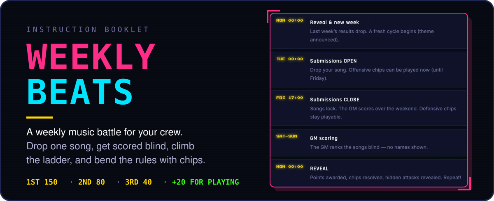
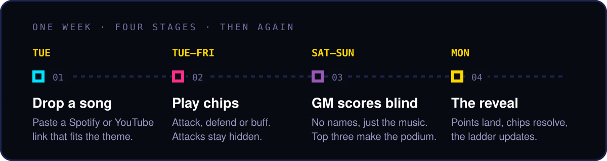
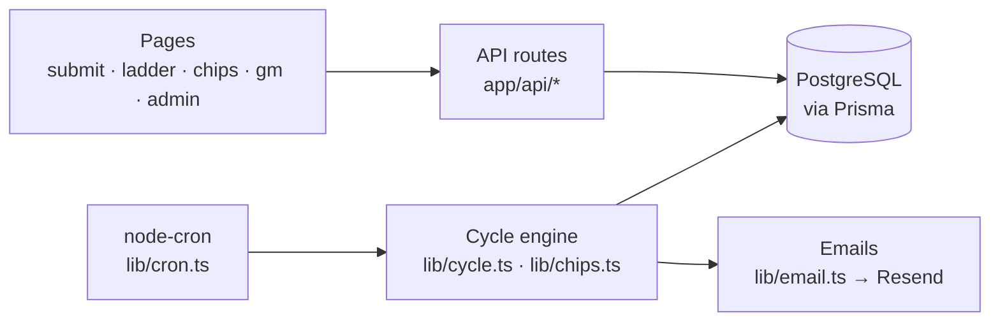

<p align="center">
  
</p>

<p align="center">
  <a href="https://devinsmusic.reviews/manual"><b>Read the game manual →</b></a>
  &nbsp;·&nbsp;
  
</p>

---

## What it does

Weekly Beats turns "send me a song you like" into a game. Every week your group gets a theme, everyone submits one song, and a rotating Game Master listens to all of them without seeing who sent what. The top three earn points, everyone who plays earns something, and a season-long ladder keeps score.

On top of that sits a chip system: 50 special moves with names borrowed from classic Pokémon attacks. Steal points, swap a rival's song, shield yourself on a hunch, or crown the next Game Master. Attacks stay hidden until the Monday reveal, so every week is a little bit of a bluff.

## How to play

<p align="center">
  
</p>

1. **Drop a song** (from Tuesday). Paste a Spotify or YouTube link that fits the week's theme, plus title and artist. One song per week.
2. **Play chips** (Tuesday to Friday). Use up to 3 a week. Offensive chips must be played before submissions close; defensive chips stay playable until the reveal.
3. **The Game Master scores blind** (weekend). Entries are anonymous, so the music is judged, not the name.
4. **The reveal** (Monday). Points are awarded, chips resolve, hidden attacks are revealed and a new week with a new theme begins.

| | Points |
|---|---|
| 1st place | 150 |
| 2nd place | 80 |
| 3rd place | 40 |
| Just for submitting | 20 |
| Weekly streak | +5 per week in a row (max 50) |

You hold up to 5 chips at once and get them from a welcome gift, achievement rewards and random drops. Nobody can be hit by more than 2 offensive chips in a week. The full rules, every chip and all achievements are in the [in-game manual](https://devinsmusic.reviews/manual), which is public and needs no account.

> [!NOTE]
> The cycle runs on a fixed schedule in Colombia time (UTC-5). Players, the Game Master and an admin are the three roles; the admin runs the cycle and picks who is GM.

---

## For developers

<details>
<summary><b>Run it locally</b></summary>

<br>

You need Node.js 18+ and a PostgreSQL database (a local Postgres or a free Supabase project both work).

```bash
npm install
cp .env.example .env          # fill in DATABASE_URL, DIRECT_URL and JWT_SECRET
npm run db:push               # create the tables from prisma/schema.prisma
npm run db:seed               # base chip catalog + achievements
npm run db:seed-expansion     # expansion chips (uses npx tsx)
npm run db:demo               # optional: demo players, cycles and submissions
npm run dev                   # http://localhost:3000
```

The demo seed prints the demo accounts it creates (all local only, password `demo1234`). The manual at `/manual` works without logging in.

Other scripts: `npm run db:studio` (browse the data), `npm run db:reset` (wipe game data and start a fresh cycle).

</details>

<details>
<summary><b>Environment variables</b></summary>

<br>

See [`.env.example`](.env.example). Never commit real values.

| Variable | Purpose |
|---|---|
| `DATABASE_URL` | Postgres connection used by the app (can be a pooled URL) |
| `DIRECT_URL` | Direct Postgres connection for Prisma schema changes |
| `JWT_SECRET` | Signs login tokens. Generate with `openssl rand -base64 32` |
| `NEXT_PUBLIC_APP_URL` | Public base URL, used in links inside emails |
| `RESEND_API_KEY` | Optional. Sends emails through Resend; without it emails are skipped |
| `EMAIL_FROM` | Optional. Sender address for emails |
| `CYCLE_REVEAL_CRON` | Reveal + archive + new cycle (default Mon 05:00 UTC) |
| `CYCLE_OPEN_CRON` | Open submissions (default Tue 05:00 UTC) |
| `CYCLE_REMINDER_CRON` | In-app reminder to players who have not submitted (default Thu 22:00 UTC) |
| `CYCLE_CLOSE_CRON` | Close submissions (default Fri 22:00 UTC) |
| `CYCLE_CLOSE_EXTENDED_CRON` | Late close when the Extra Time chip is active (default Sat 22:00 UTC) |

</details>

<details>
<summary><b>How it's built</b></summary>

<br>

- **Next.js 14** (App Router) for both the pages and the API routes under `app/api/`.
- **Prisma + PostgreSQL** for players, weekly cycles, submissions, points ledger, achievements and chips.
- **JWT auth** (bcrypt-hashed passwords) with Player, Game Master and Admin roles.
- **node-cron**, started once from `instrumentation.ts`, drives the weekly cycle.
- **Tailwind CSS** plus a hand-made retro theme (pixel fonts, neon tokens in `app/globals.css`).
- **Resend** for transactional emails (results, chip hits, achievements).



| Path | What's there |
|---|---|
| `app/` | Pages: home, submit, ladder, archive, chips, gm, admin, profile, manual |
| `app/api/` | API routes (auth, submissions, chips, GM scoring, admin tools) |
| `lib/cycle.ts` | Weekly cycle: open, close, reveal, scoring |
| `lib/chips.ts` | Chip resolution engine |
| `lib/cron.ts` | Weekly schedule |
| `prisma/schema.prisma` | Data model |
| `prisma/*seed*.ts` | Chip catalog, achievements and demo data |
| `app/manual/manualData.ts` | Source of the public game manual |

</details>

<details>
<summary><b>Deployment</b></summary>

<br>

The live game runs as a Node app on shared hosting that can't run `next build`, so the build happens locally and the compiled `.next/` folder is committed. On the server, [`deploy.sh`](deploy.sh) pulls `main`, installs dependencies only if the lockfile changed, runs `prisma generate` and `prisma db push`, then restarts the app. [`server.js`](server.js) is the production entry point.

</details>

## Documentation

| Doc | What it's for |
|---|---|
| [Game manual](https://devinsmusic.reviews/manual) | Player-facing rules, every chip and the achievements (source: [`app/manual/`](app/manual)) |
| [`docs/EXPANSION.md`](docs/EXPANSION.md) | Design spec for the chip expansion: activation model v2, new chips, achievements and notifications |
| [`AGENTS.md`](AGENTS.md) | Notes for AI coding agents working in this repo |

---

<sub>A personal side project by <a href="https://github.com/Lu1sgui">Lu1sgui</a>, built for a weekly music game among friends.</sub>
